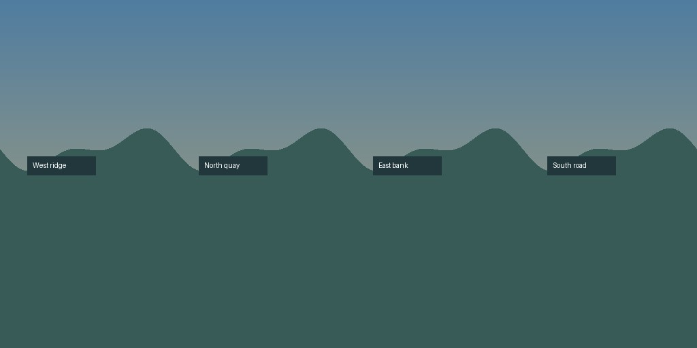

# Leonida Panorama VR

**Stand inside a panorama you captured.** Drag to turn along the horizon on desktop, or look around the same image with a compatible WebXR headset.



## Look around the practice scene

```sh
python -m http.server 8000
```

Open [localhost on port 8000](http://localhost:8000), then drag across the scene or use the arrow keys. The image above is the original practice panorama laid flat.

## Load a capture

Choose **360° panorama** and pick a stitched **2:1 equirectangular** JPG or PNG. For immersive mode, use a secure context and a compatible WebXR headset, then select **Enter VR**.

The panorama is monoscopic. Each eye uses the headset’s projection and orientation to view the same captured scene. This project displays still captures outside GTA VI. Physical-headset testing remains open.

---

[Explore the GTA VI project collection](https://github.com/Berserk-hub150/gta6-resource-index) · Independent fan project. Grand Theft Auto is a trademark of its respective owners.
